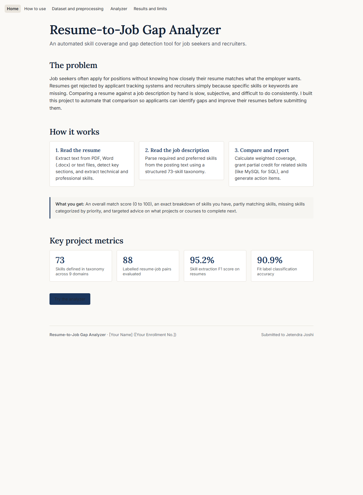
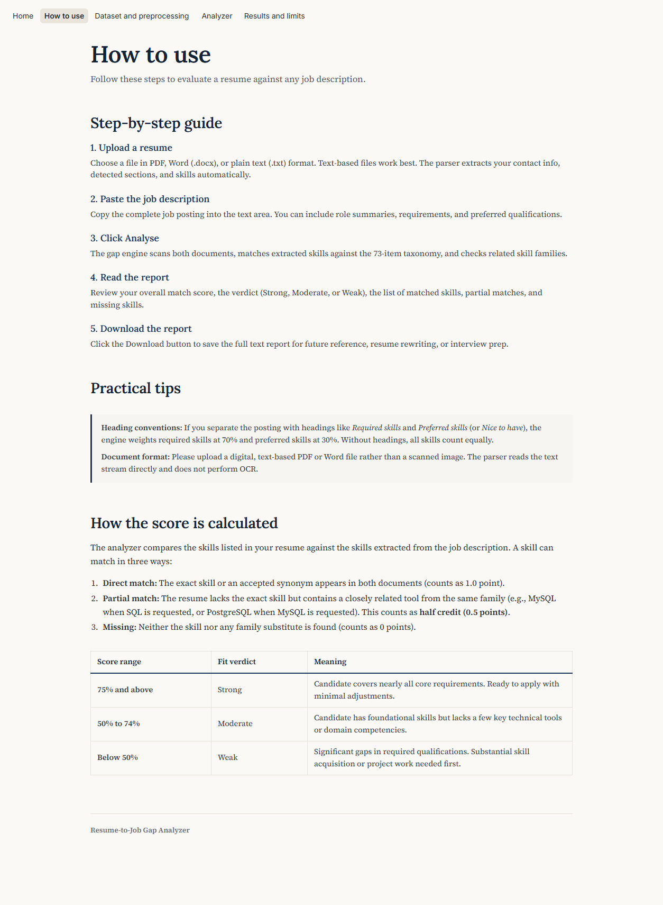
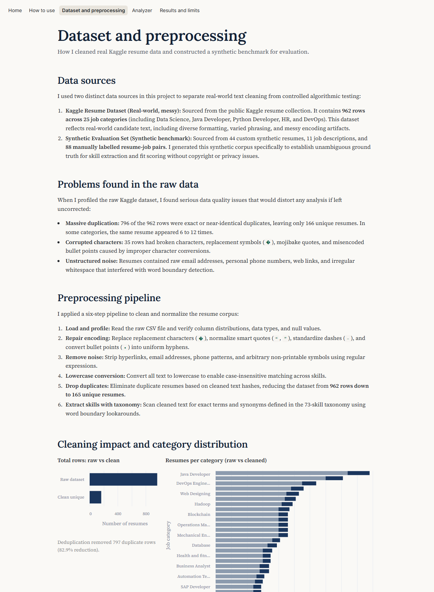
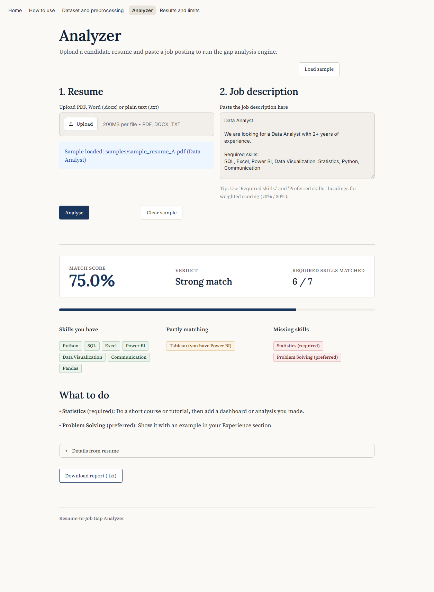
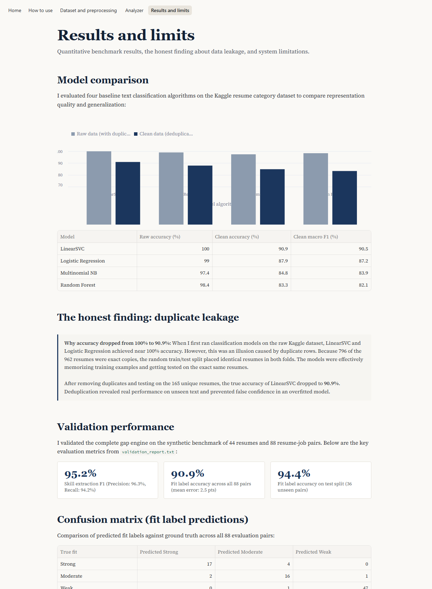

# Resume-to-Job Gap Analyzer

An automated skill coverage and gap detection web application that compares a candidate's resume against a job description. The system identifies exact skill matches, grants partial credit for closely related technical families (such as MySQL when SQL is requested), detects missing requirements, and provides actionable recommendations.

This project was built as a college workplan project (P4), submitted to **Jetendra Joshi**.

---

## Key Results & Metrics

All metrics are benchmarked on the evaluation corpus and verified via `validate.py`:

| Metric | Score | Details |
| :--- | :--- | :--- |
| **Skill Extraction F1** | **95.2%** | Precision 96.3%, Recall 94.2% across 44 resumes |
| **Fit Classification Accuracy** | **90.9%** | Evaluated across 88 labelled resume-job pairs |
| **Unseen Test Split Accuracy** | **94.4%** | Evaluated on 36 held-out test pairs |
| **Mean Score Error** | **2.5 pts** | Predicted score vs ground-truth score (0.987 correlation) |
| **Missing Requirement Detection** | **98.6% Prec / 98.9% Rec** | Identification of missing mandatory skills |
| **Best Baseline Classifier** | **LinearSVC (90.9%)** | On clean deduplicated Kaggle categories (vs 100% on raw leaked data) |

---

## Screenshots

### 1. Home
Problem statement, end-to-end workflow, and high-level evaluation metrics.


---

### 2. How to Use
Step-by-step instructions, formatting tips (headings and document types), and scoring rubrics.


---

### 3. Dataset and Preprocessing
Exploration of real Kaggle resume data vs synthetic benchmark, duplicate leakage analysis, text cleaning pipeline, and taxonomy breakdown.


---

### 4. Analyzer (Working Tool)
Interactive analyzer with one-click sample loading, match score calculation (75.0% Strong match on sample), skill tags, and targeted action items.


---

### 5. Results and Limitations
Model comparisons, the honest finding regarding train/test duplicate leakage, full validation confusion matrix, and system limitations.


---

## System Architecture & Workflow

1. **Resume Parser (`resume_parser.py`)**:
   - Ingests PDF, DOCX, or plain text files.
   - Cleans formatting, repairs encoding errors, and removes non-standard symbols.
   - Segments text into standard sections (*summary*, *skills*, *experience*, *education*, *projects*, *certifications*).
   - Extracts skills using regex word-boundary lookarounds against a curated 73-skill taxonomy across 9 technical and professional categories.

2. **Gap Engine (`gap_engine.py`)**:
   - Parses job descriptions into *Required* and *Preferred* sections using section keyword heuristics.
   - Categorizes skills into direct matches, family partial matches (e.g., SQL family, NoSQL family, Cloud family), and missing skills.
   - Weights coverage: 70% required skills, 30% preferred skills.
   - Produces fit verdicts: **Strong** (>= 75%), **Moderate** (50% to 74%), or **Weak** (< 50%).
   - Maps missing skills to actionable advice for portfolio additions or short-term coursework.

3. **Multi-Page Web Interface (`app.py` & `views/`)**:
   - Configured with `st.navigation` using top navigation tabs.
   - Minimalist, handcrafted design with calm neutral paper tones (`#FAF9F6`), serif typography (`Lora`), and deep navy accents (`#1B365D`).
   - Free of AI-template clutter, glowing badges, or decorative gradients.

---

## Project Structure

```text
resume-to-job-gap-analyzer/
├── .streamlit/
│   └── config.toml                  # Streamlit theme (neutral palette, serif font)
├── assets/
│   └── logo.png                     # Optional institutional logo (skipped if missing)
├── data/
│   ├── job_descriptions.csv         # 11 synthetic job descriptions
│   ├── pair_labels.csv              # 88 labelled resume-job benchmark pairs
│   └── resumes.csv                  # 44 synthetic resumes
├── results/
│   ├── model_comparison.csv         # Classifier benchmark results (raw vs clean)
│   ├── preprocessing_example.csv    # Real before/after text cleaning excerpt
│   └── real_category_counts.csv     # Kaggle 25-category distribution (raw vs clean)
├── samples/
│   ├── jd_backend_developer.txt     # Sample backend job description
│   ├── jd_data_analyst.txt          # Sample data analyst job description
│   ├── sample_resume_A.pdf          # Sample candidate resume (Data Analyst, 75.0% fit)
│   └── sample_resume_B.docx         # Sample candidate resume (Word doc format)
├── screenshots/                     # UI screenshots of all 5 website pages
│   ├── 1_home.png
│   ├── 2_how_to_use.png
│   ├── 3_dataset_and_preprocessing.png
│   ├── 4_analyzer.png
│   └── 5_results_and_limits.png
├── views/
│   ├── home.py                      # Page 1: Problem statement & overview
│   ├── how_to_use.py                # Page 2: Step-by-step user guide
│   ├── dataset_and_preprocessing.py # Page 3: Kaggle data & cleaning pipeline
│   ├── analyzer.py                  # Page 4: Interactive resume gap analyzer
│   └── results_and_limits.py        # Page 5: Validation report & honest findings
├── app.py                           # Main application entrypoint
├── data_loader.py                   # Safe data loader handling missing files gracefully
├── gap_engine.py                    # Core analysis and scoring engine
├── resume_parser.py                 # Document text extraction and skill parsing
├── site_config.py                   # Student and project metadata configuration
├── skills_taxonomy.csv              # 73-skill dictionary with categories and families
├── ui_components.py                 # Editorial CSS, navigation helpers, and footer
├── validate.py                      # Validation script verifying F1 and fit accuracy
├── validation_report.txt            # Benchmark output summary
├── validation_results.csv           # Detailed predictions for confusion matrix
└── requirements.txt                 # Python package dependencies
```

---

## Local Setup & Execution

### 1. Clone the repository
```bash
git clone https://github.com/<your-username>/resume-gap-analyzer.git
cd resume-gap-analyzer
```

### 2. Create and activate a virtual environment
```bash
python -m venv venv
# On Windows:
.\venv\Scripts\activate
# On macOS / Linux:
source venv/bin/activate
```

### 3. Install dependencies
```bash
pip install -r requirements.txt
```

### 4. Run validation benchmark
Confirm that the gap engine and skill extraction meet the target benchmarks:
```bash
python validate.py
```
*Expected output:*
- Skill extraction F1: **95.2%** (Precision: 96.3%, Recall: 94.2%)
- Fit label accuracy: **90.9%** (All 88 pairs) / **94.4%** (Test set)

### 5. Launch the Streamlit application
```bash
streamlit run app.py
```
Open your browser to `http://localhost:8501`.

---

## Configuration

To customize student or institutional details, edit `site_config.py`:
```python
NAME = "Your Name"
ENROLLMENT = "Your Enrollment No."
SUBMITTED_TO = "Jetendra Joshi"
PROJECT = "Resume-to-Job Gap Analyzer"
```
To display an institutional logo in the header, place an image at `assets/logo.png`. If absent, the header quietly renders without it.

---

## Streamlit Community Cloud Deployment

1. Push this repository to GitHub (e.g. `resume-gap-analyzer`).
2. Visit [share.streamlit.io](https://share.streamlit.io/) and log in with GitHub.
3. Click **New app**.
4. Select your repository: `<your-username>/resume-gap-analyzer`.
5. Set **Main file path** to: `app.py`.
6. Click **Deploy!**.

---

## License & Credits
Developed as an academic project for P4 workplan requirements. Sourced Kaggle dataset used for educational benchmarking under CC0 / Open Public License.
